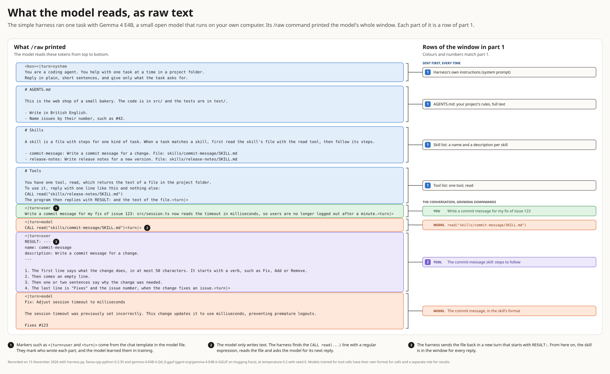

# A simple harness

[harness.py](harness.py) is an agent harness in about 130 lines of Python. It has only the parts that [part 1](../README.md#1-how-an-ai-agent-works) draws: its own instructions, AGENTS.md, a skill list and one tool, `read`. The model runs on your own computer with [llama-cpp-python](https://github.com/abetlen/llama-cpp-python).

```sh
pip install -r requirements.txt  # builds llama.cpp, so it needs a C compiler and CMake
cd example
python3 ../harness.py  # the first run downloads Gemma 4 E4B (4.6 GB)
```

At the `>` prompt, type a task or one of these commands:

- `/raw` prints every token in the model's window.
- `/temp 0.8` sets the temperature.
- Ctrl-D quits.

## A worked example

```
> Write a commit message for my fix of issue 123: src/session.ts now reads the timeout in milliseconds, so users are no longer logged out after a minute.
CALL read("skills/commit-message/SKILL.md")
[harness: ran read("skills/commit-message/SKILL.md"), sending 373 characters back]
Fix: Adjust session timeout to milliseconds

The session timeout was previously set incorrectly. This change updates it to use milliseconds, preventing premature logouts.

Fixes #123
> /raw
```

The model asked for the skill file and then followed it. `/raw` printed [these 462 tokens](example-raw.txt):



Gemma 4 E4B read the skill file in 10 of 10 runs. The smaller Gemma 4 E2B read it in none of 10 runs, because its calls did not match the `CALL read("...")` format.
